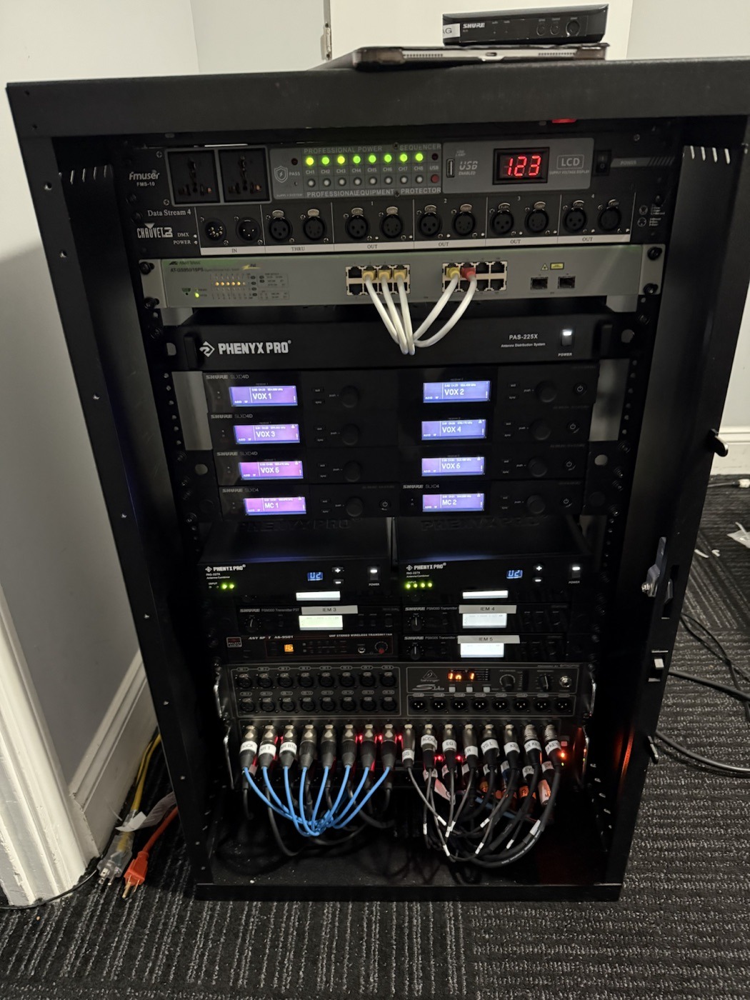
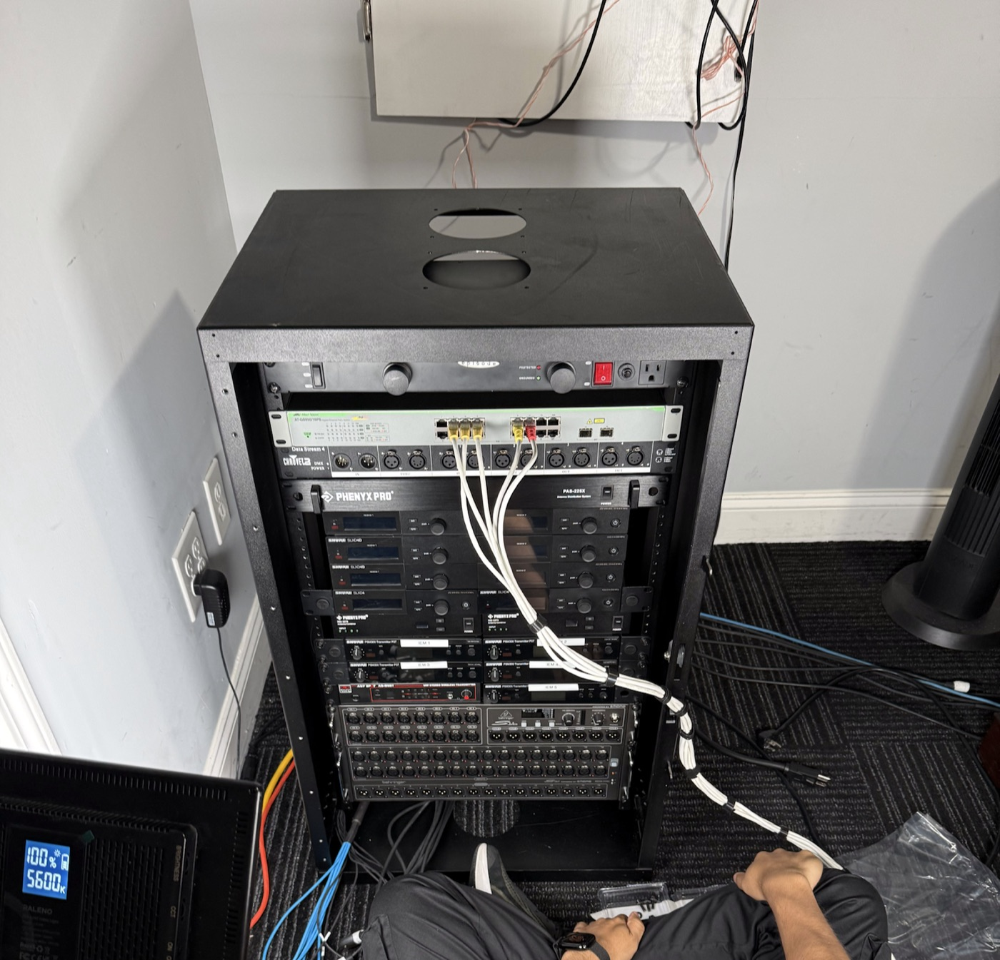
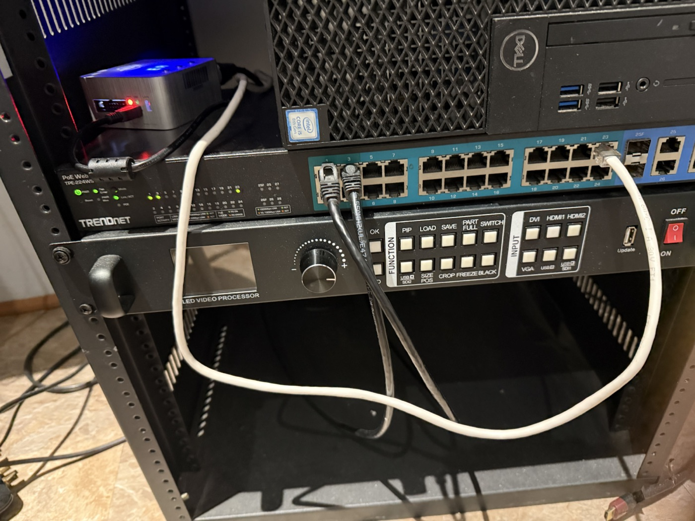
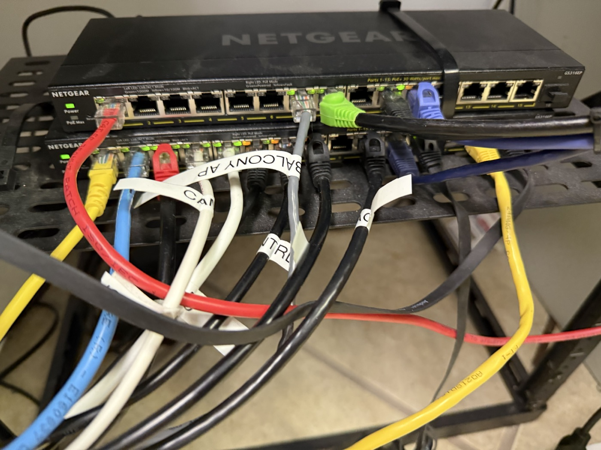
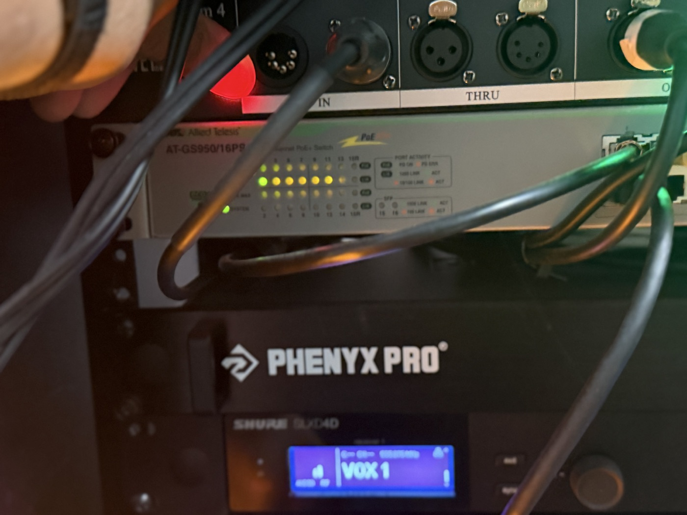
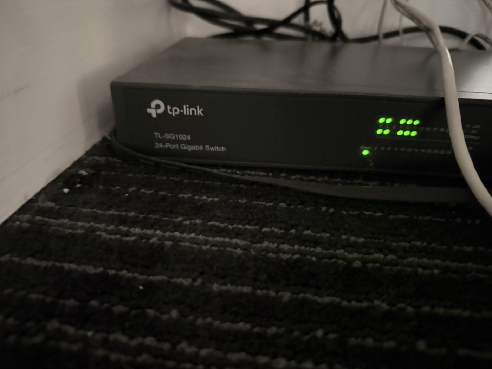

# Daniel Shaji · Network & AV Fieldwork

A field portfolio of network and audiovisual installation work, from active installs to completed systems.

## Selected work

| Wireless & monitoring rack | Rack build in progress |
|:--|:--|
|  |  |

| Signal and network hardware | Switching and cable runs |
|:--|:--|
|  |  |

| Wireless audio integration | Access switching |
|:--|:--|
|  |  |

## Visit the portfolio

[Open the live portfolio site](https://danielshaji1.github.io/network-av-showcase/). The responsive gallery is built from [`index.html`](index.html).

The displayed previews are optimized JPEGs. Full-resolution HEIC originals are in `images/` and linked from the site.

## Add photos

1. Put the original photo in `images/`.
2. Export a web preview to `images/previews/` as a JPEG (about 1400 pixels on the long edge).
3. Add a gallery card in `index.html` with the preview path, original path, descriptive alt text, and a short caption.
4. Add the preview and caption to the table above. Keep filenames stable and remove `.DS_Store` files before committing.

Before publishing, check photos for customer names, addresses, network diagrams, serial numbers, passwords, or other sensitive details, and get permission to publish customer-site photos.
