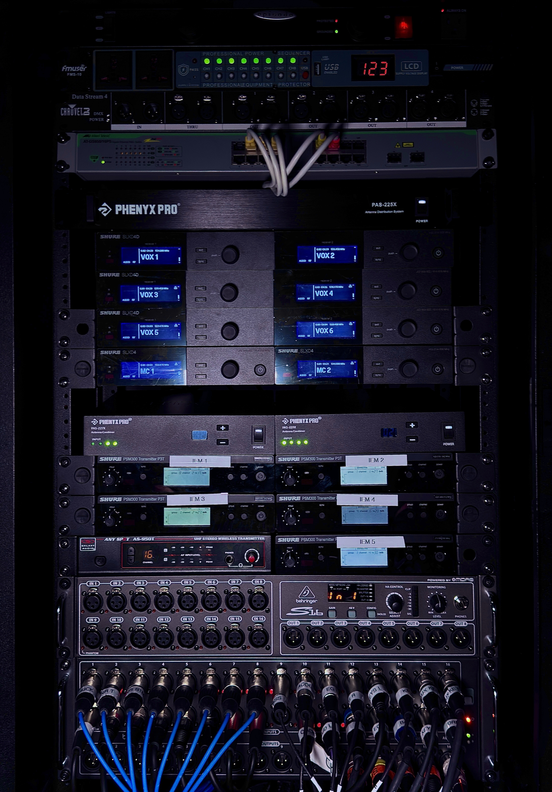

# Network & AV Installation Showcase

Selected photos of network and audiovisual systems I install, support, and bring to life. The full portfolio page is in [`index.html`](index.html).

## Wireless and monitoring rack

Integrated wireless microphones, in-ear monitoring, audio distribution, and networked control in a touring-ready rack.

## Add a project

1. Add project photos under `images/` (JPG, PNG, or WebP work well).
2. In `index.html`, duplicate an existing `<article class="card">` and update the image path, alt text, category, title, and short description.
3. Add the photo to this README with `` and update the project count in the page.

Before publishing, make sure photos do not reveal customer names, addresses, network diagrams, serial numbers, passwords, or other sensitive details. Get permission to publish customer-site photos.

## Preview and hosting

Open `index.html` in a browser, or run `python3 -m http.server 8000` from this directory and visit `http://localhost:8000`.

To publish the page with GitHub Pages, open **Settings → Pages**, choose **Deploy from a branch**, select `main` and `/ (root)`, then save.
